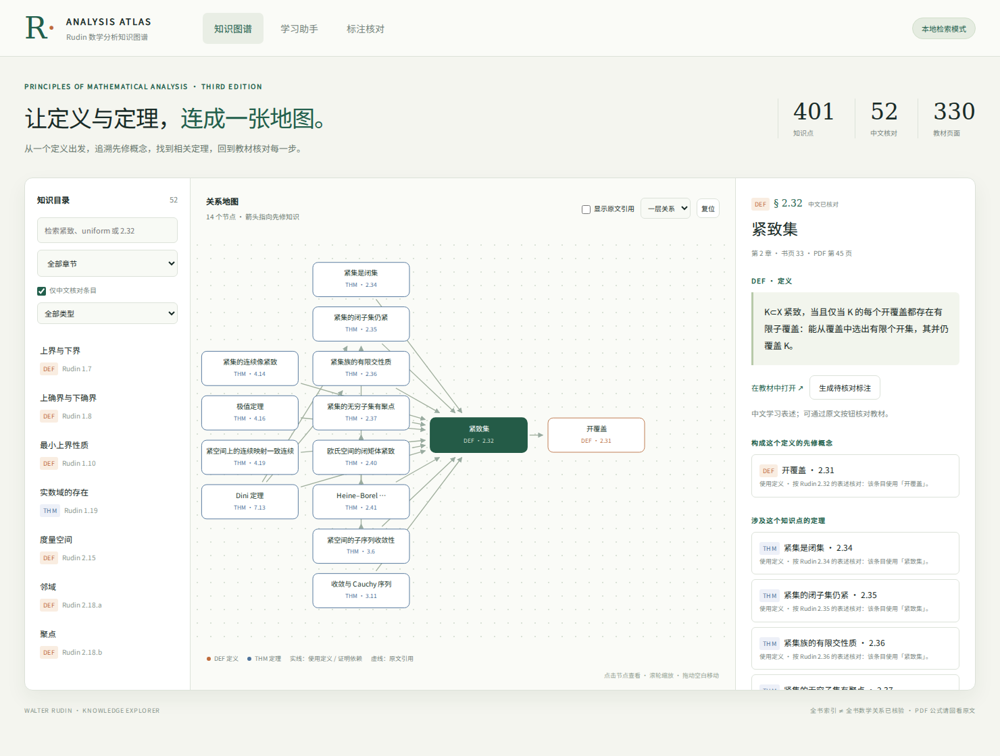
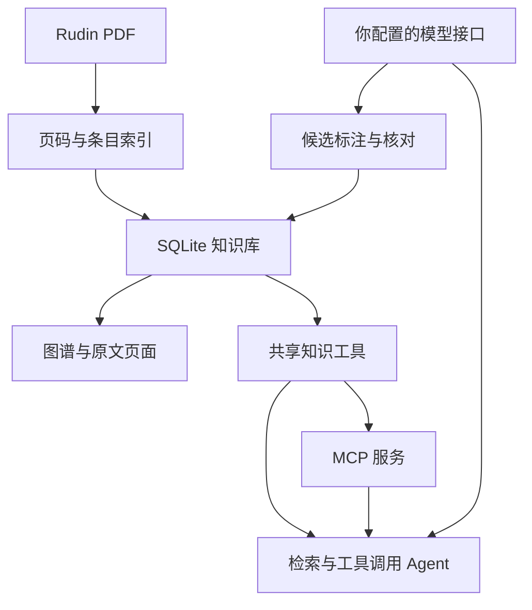

# Rudin Knowledge Agent · 数学分析知识图谱

一个本地可运行的数学分析学习项目：**PDF 教材 → 带来源的知识点 → 定义与定理关系图 → 检索增强 Agent → MCP 服务**。

项目以你上传的 Walter Rudin《Principles of Mathematical Analysis》第三版为教材，附有该 PDF，默认在你的电脑上运行。

## 已完成什么

- 全部 11 章、330 个 PDF 页的文本索引。
- 391 个匹配到的带编号原文条目，细分 2.18 的定义后共 401 个节点。
- 52 个中文核心知识点、100 条经对照原文整理的概念/定理关系。
- 330 条从原文明确引用中提取的 `references` 边；这些边**不是已确认的证明依赖**。
- 网页知识目录、章节与类型筛选、可点击/缩放/拖动的局部关系图。
- DEF 定义、THM 假设与结论、先修知识、涉及当前定义的定理、教材页跳转。
- 无 Key 本地检索；填 Key 后启用多轮工具调用 Agent、可追溯引用与调用记录。
- 独立 MCP 服务：6 个工具、一个资源模板、一个提示词。
- 可选 Agent → MCP stdio 的真实协议调用。
- AI 分批抽取、原文证据验证、候选人工核对、通过后入图、JSON 导出。
- 可选嵌入索引和混合检索，不需要先配置 Qdrant 或 Neo4j。

**当前是可运行的 v0.1 项目，不是全书数学关系已核验的最终数据库。** 未中文整理的条目保留英文原文；自动提取公式可能丢失上下标或排版。全书细致的语义标注需要配置模型后逐章抽取并核对。不是形式化证明系统。



## 1. 启动（先不填 API Key）

需要 Python 3.11 或更高版本。Windows 可直接双击 `start.bat`；macOS/Linux 运行 `bash start.sh`。

手动方式（Windows PowerShell）：

```powershell
cd rudin-agent
python -m venv .venv
.\.venv\Scripts\python.exe -m pip install -e ".[dev]"
Copy-Item .env.example .env
.\.venv\Scripts\python.exe -m rudin_agent.cli serve
```

macOS/Linux：

```bash
cd rudin-agent
python3 -m venv .venv
.venv/bin/python -m pip install -e '.[dev]'
cp .env.example .env
.venv/bin/python -m rudin_agent.cli serve
```

浏览器打开 **http://127.0.0.1:8000**。API 文档在 **http://127.0.0.1:8000/docs**。

启动时自动初始化 SQLite；目录默认只展示 52 个中文核对条目。取消“仅中文核对条目”即可查看全书索引。选择 `2.32 紧致集`，右侧会显示定义以及 2.34、2.35、3.6、4.14、4.19 等相关定理。

不要把包含 API Key 的 `.env` 提交到 Git。默认服务绑定 `127.0.0.1`；这是本地应用，没有面向公网的用户认证。

## 2. 填写你自己的模型接口

在 `.env` 中填写：

```dotenv
LLM_BASE_URL=https://你的提供商/v1
LLM_API_KEY=你的密钥
LLM_MODEL=你有权限使用的模型名
AGENT_TOOL_TRANSPORT=local
```

后端使用 OpenAI-compatible `POST /chat/completions`。`LLM_BASE_URL` 填接口根路径，不要包含 `/chat/completions`；模型需要支持 `tools` 工具调用。

重启服务后，打开“学习助手”提问：

- 紧致集的定义是什么？哪些定理使用这个定义？
- 解释 4.19 定理为什么与紧致性、一致连续的定义有关。
- 一致收敛的量词顺序是什么？它和 Dini 定理有何关系？

后端先检索候选，再允许模型调用知识工具。回答给出 `[2.32]` 或 `[PDF:p45]` 等标注。来源按钮跳转教材，工具记录展示执行过程。引用校验只检查引用是否来自已读取证据，**不会证明回答在数学上正确**。

当前未使用真实外部模型进行联调，因为没有你的 API Key；工具调用与引用处理已用可控模型响应及真实 MCP 协议测试。

## 3. 让 Agent 通过 MCP 调用知识库

把配置改成：

```dotenv
AGENT_TOOL_TRANSPORT=mcp
```

重启后每次 AI 问答会建立 stdio MCP 连接，实际调用同一知识库的 MCP 工具。`local` 模式直接调用共享工具函数，启动开销更小。

向支持 MCP 的外部宿主提供知识库时，用项目虚拟环境启动：

```bash
python -m rudin_agent.mcp_server
```

宿主配置示例见 `docs/mcp-client.example.json`，把 `command`、`cwd`、`RUDIN_DB`、`PYTHONPATH` 换成你电脑上的绝对路径。不同宿主的配置外层可能不同。

可选 Streamable HTTP：

```bash
python -m rudin_agent.mcp_server --http
```

默认地址 `http://127.0.0.1:8001/mcp`。本项目锁定 MCP SDK v1 范围，以保持已测试的 FastMCP 接口一致。

| MCP 工具 | 作用 |
| --- | --- |
| `search_knowledge(query, limit)` | 按中文、英文、编号检索知识点 |
| `get_knowledge_point(id)` | 读取完整表述、先修关系、相关定理 |
| `get_neighborhood(id, depth)` | 获取带关系类型的局部图谱 |
| `find_dependency_path(start, end)` | 沿“当前知识 → 先修知识”方向追溯 |
| `read_source(pdf_page)` | 获取原文页与书页标签 |
| `search_source(query, limit)` | 检索全书原文页，适合英文词 |

资源 `rudin://point/{id}`；提示词 `explain_definition(id)`。

## 4. 逐章补充知识点

详情页的“生成待核对标注”只处理当前条目。也可通过 CLI 分批处理：

```bash
python -m rudin_agent.cli extract --chapter 2 --limit 10
python -m rudin_agent.cli extract --id 9.24
python -m rudin_agent.cli extract --all --limit 20
python -m rudin_agent.cli proposals
```

默认跳过已中文核对和已有候选的条目；重复运行会继续后面的索引条目。失败条目保留原样，可再次执行。`--id` 用于指定条目重新标注。操作会使用模型 API，`--limit` 控制当次条目数量。

在网页“标注核对”页对照原文检查，确认量词、空间、假设、结论及关系，再点击“核对并通过”。CLI 同样支持：

```bash
python -m rudin_agent.cli review 9.24 --approve
# 不加 --approve 表示丢弃这个候选
python -m rudin_agent.cli review 9.24
python -m rudin_agent.cli export --output data/export.json
```

抽取边必须有已存在的目标节点、允许的关系类型和原文逐字证据；验证不通过则不写候选。通过前不会覆盖正式条目。逐字证据校验只能阻止部分伪造，数学依赖仍需人工核对。当前抽取增强已有条目，不自动发现所有未编号知识点，也不自动把多定义条目全部拆开；新增节点可编辑 `data/curated.json` 后重新初始化数据库。

## 5. 可选嵌入接口

不填写嵌入配置也能工作。若要使用支持 `/embeddings` 的接口：

```dotenv
EMBED_BASE_URL=https://你的嵌入提供商/v1
EMBED_API_KEY=你的嵌入密钥
EMBED_MODEL=你的嵌入模型名
```

然后运行：

```bash
python -m rudin_agent.cli embed
```

向量保存在 SQLite。Agent 检索使用词法检索与向量检索的 Reciprocal Rank Fusion；网页目录和外部 MCP 的 `search_knowledge` 使用词法检索。变更知识表述后需重新运行 `embed`。

## 6. 架构与接口



主要接口位置见 `docs/architecture.md`。模型、嵌入服务通过 Protocol 和独立实现类隔离。关系和知识点采用 JSON，存储层独立放在 `store.py`，可扩展图数据库；当前提案核对模块直接使用 SQLite 的事务与 metadata 表，替换数据库时也要迁移这部分代码，尚未提供现成的 Neo4j/Qdrant 适配器。

## 7. 测试与常用命令

```bash
python -m pytest -q
python -m rudin_agent.cli stats
python -m rudin_agent.cli ask "紧致集"
```

13 个测试覆盖章节与页码、定义与定理关系、依赖方向、检索、参数验证、Agent 工具调用及未检索引用、候选隔离、向量维度、HTTP 流程、真实 MCP stdio 和 Agent→MCP。`docs/verification.md` 记录本次验证。

`build_seed.py` 重建原文索引与中文种子 JSON；`reindex` 命令重建当前数据库，会清除已有候选、向量和自定义变更，执行前备份数据库。更换 `.env` 中的 PDF 后需运行 `reindex`；不同文件哈希不会套用当前版中文种子，避免页码错配。

## 资料

- [MCP Python SDK v1 官方文档](https://py.sdk.modelcontextprotocol.io/v1/)
- [FastAPI 官方文档](https://fastapi.tiangolo.com/)
- 教材来源：你上传的 Rudin 第三版 PDF；书页码与 PDF 页码不相同。源码包中的教材与派生索引用于你的学习项目，未发布到公共网站。

前端附带 Noto Sans SC 简体中文字体，使用 SIL Open Font License；许可见 `web/fonts/OFL.txt`。
